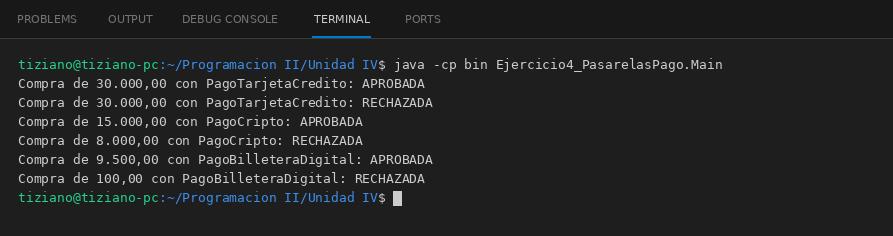

# ProcesadorPago

Programación II - Unidad 4 - Ejercicio 4

## Consigna
Procesar pagos del carrito con distintas pasarelas mediante una orden de cobro universal.

## Lógica
- Interfaz `ProcesadorPago` con `boolean efectuarCobro(double monto)`.
- `PagoTarjetaCredito` controla el límite disponible, `PagoCripto` convierte a USD y controla el saldo, `PagoBilleteraDigital` exige que el token presentado coincida con el autorizado.
- Cada pasarela descuenta el saldo solo si el cobro es aprobado y devuelve `false` si es inválido.
- `CarritoCompras.finalizarCompra(pasarela, total)` acepta cualquier `ProcesadorPago` e informa APROBADA o RECHAZADA.
- `Main`: compras con cada pasarela, incluyendo rechazos por saldo y por token falso.

## Ejecución

